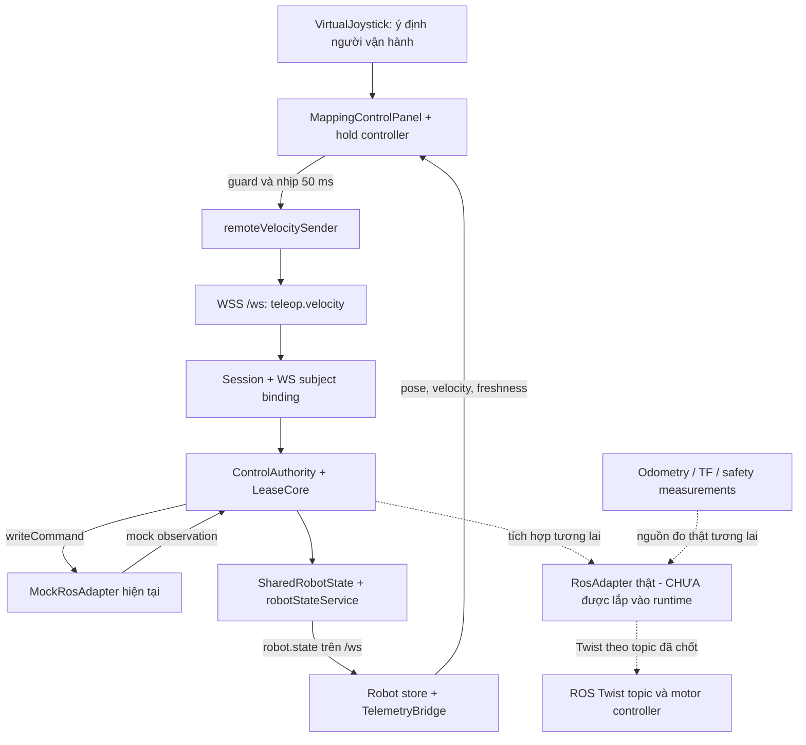

# ROBOT_HMI — Hướng dẫn kiến trúc, luồng ROS 2 và đọc hiểu source

Ngày rà soát: **15/10/2026**. Đối tượng: kỹ sư mới tiếp quản hệ thống.

## 1. Phạm vi và cách sử dụng báo cáo

Đây là tài liệu mô tả **implementation đang có**, kèm các giới hạn phát hiện khi đọc source. Các đề xuất ở cuối tài liệu là công việc tương lai, không phải tính năng đã triển khai. Đợt này chỉ thêm comment trong source; không sửa thuật toán, timeout, cấu hình, schema, test, database hoặc kết nối motor.

| Đường dẫn trong yêu cầu Windows | Checkout thực tế được kiểm tra trên Ubuntu | HEAD trước khi thêm comment |
| --- | --- | --- |
| `C:\Users\nnqua\Desktop\ROBOT_HMI` | `/home/vistar/projects/ROBOT_HMI` — branch `combine` | `214af07709783bc14446f757ada915f67439a5c3` |
| `C:\Users\nnqua\Desktop\ros2_amr_UI` | `/home/vistar/projects/ros2_ws` — có package `src/camera` tương ứng | `10afe8af89dc04cba55c27b705621c8336934b1c` |

Hai working tree sạch khi bắt đầu. Không truy cập được checkout Windows để chứng minh nó đồng nhất byte với Ubuntu; các nhận xét và comment chỉ áp dụng cho hai checkout trong bảng. Header camera thực tế ở **`src/camera/include/intel_camera_node.hpp`**, implementation ở `src/camera/src/intel_camera_node.cpp`.

Thứ tự tin cậy khi gặp mâu thuẫn: source hiện tại cho biết hành vi; test/evidence chỉ chứng minh phạm vi và phiên bản đã chạy; kế hoạch cho biết mục tiêu; tài liệu lịch sử giải thích quá trình. Một dòng “đã PASS” trong nhật ký cũ không nghiệm thu HEAD mới.

**Các điểm cần sửa cách hiểu ngay từ đầu:**

| Mô tả dễ hiểu nhầm | Thực tế trong checkout |
| --- | --- |
| Mất command 500 ms thì watchdog dừng | `commandTimeoutMs=300`; **500 ms là TTL freshness token**. Node không phải hệ điều hành realtime. |
| Ảnh đi zero-copy từ ROS lên browser | Có `cv::Mat::clone`, `memcpy`, `bytes(msg.data)` và pipe liên tiến trình. |
| `MAX_SOURCE_AGE_S` đo tuổi từ lúc sensor chụp | Nó đo thời gian từ lúc gateway đặt ảnh vào slot; chưa kiểm `msg.header.stamp`. |
| Camera ROS thật đồng nghĩa map/teleop ROS thật | `runtime.js` vẫn tạo `MockRosAdapter`. Camera dùng đường ROS riêng. |
| Backend nén OccupancyGrid trước khi stream | Đang gửi snapshot JSON; WebSocket tắt `perMessageDeflate`. Raster/PNG được tạo ở frontend. |
| `available: true`, HTTP 201 hoặc có track nghĩa là thấy hình mới | Cần thêm đường ICE/DTLS, giải mã và frame callback. Danh mục camera hiện là cấu hình tĩnh. |
| Nút Stop trên web là E-stop phần cứng | Stop là yêu cầu phần mềm, phải chờ observation xác nhận; E-stop vật lý là tín hiệu độc lập. |

## 2. Hệ thống giải quyết bài toán gì?

HMI là giao diện để người vận hành nhìn trạng thái robot, chọn đích và waypoint, tạo/lưu bản đồ, quan sát camera và lái tay khi mapping. Người dùng làm việc trong trình duyệt; quyền phát lệnh chuyển động phải do một authority phía server quyết định. Hai người nhìn cùng robot được, nhưng hai joystick không được đồng thời điều khiển cùng robot.

Có ba loại dữ liệu với nhu cầu khác nhau:

1. **Giao dịch**: login, xin lease, start/finish mapping, tạo mission. Cần request/response, báo lỗi, kiểm tra quyền và chống tạo trùng. Dùng HTTP API.
2. **Trạng thái và lệnh liên tục**: robot pose, job/mission events, heartbeat, velocity. Cần kết nối lâu dài, thứ tự và giới hạn backlog. Dùng WebSocket `/ws`; grid lớn dùng `/map-stream` riêng.
3. **Video**: cần codec và phát hình liên tục. Gateway mã hóa VP8; MediaMTX cung cấp WHEP để đàm phán WebRTC. Video không chạy qua `/ws` hay qua Express từng frame.

React không tự thực hiện SLAM hoặc Nav2. Trong bản hiện tại, thuật toán map/mission có nguồn mô phỏng phục vụ kiểm thử; bước ROS robot thật cần adapter, nguồn đo và nghiệm thu riêng.

### 2.1. Cấu trúc thư mục

```text
/home/vistar/projects/
├── ros2_ws/
│   └── src/camera/
│       ├── include/           # Khai báo IntelCameraNode và CameraHandling
│       ├── src/               # USB RealSense, OpenCV, ROS publishers
│       ├── CMakeLists.txt     # C++17, rclcpp, sensor_msgs, OpenCV, librealsense2
│       └── package.xml        # Metadata/dependencies package ROS
└── ROBOT_HMI/
    ├── frontend/src/
    │   ├── pages/             # Navigation, Mapping, GestureDetection, Login
    │   ├── components/        # Camera, map, joystick, trạng thái
    │   ├── clients/           # Mock/remote facade, HTTP/WS, WHEP reader
    │   ├── state/ và stores/  # Zustand workflow/robot/control state
    │   ├── schemas/           # Re-export tương thích từ contracts
    │   └── utils/             # Điều phối, freshness, tọa độ, raster
    ├── backend/src/
    │   ├── server.js          # Composition root, listen và shutdown
    │   ├── runtime.js         # Một robot state và authority dùng chung
    │   ├── auth/              # Session, Passport, CSRF, WS auth
    │   ├── routes/            # HTTP boundary và DTO
    │   ├── services/          # Camera grants, map, mapping, mission, job
    │   ├── realtime/          # Connection registry, queue có giới hạn
    │   ├── control/           # Bind người gửi với WS/tab, HTTP lease/stop
    │   ├── ros/               # MockRosAdapter, capability, bộ đổi grid ROS
    │   ├── db/                # Transaction, ledger, persistence, recovery
    │   └── storage/           # File assets, hash, ghi nguyên tử
    ├── packages/contracts/    # Zod: một nguồn schema chuẩn
    ├── packages/control-domain/ # Logic quyền lái/safety dùng chung
    ├── tools/ros-camera/      # Python subscriber, encoder, MediaMTX, TLS/LAN
    └── docs/test/             # Node/browser tests đang hiện diện
```

### 2.2. Sơ đồ khối hệ thống hiện tại

Đây là sơ đồ kiến trúc dạng block, không phải mô hình SysML đầy đủ với stereotype/constraint được công cụ SysML kiểm chứng.

```mermaid
flowchart LR
  subgraph Sensor[Phần cứng và ROS 2]
    F[RealSense trước]
    R[RealSense sau]
    D[CameraHandling + IntelCameraNode]
    T[ROS 2 Image topics]
    F -->|USB BGR8| D
    R -->|USB BGR8| D
    D -->|DDS publish| T
  end
  subgraph Host[Máy Ubuntu chạy gateway và HMI]
    G[Python CameraGateway]
    E[Hai tiến trình GStreamer VP8]
    M[MediaMTX]
    P[Vite HTTPS proxy]
    B[Express HTTP + ws]
    DB[(PostgreSQL)]
    RT[Runtime + ControlAuthority]
    MOCK[MockRosAdapter]
    T -->|subscribe best effort| G
    G -->|BGR bytes qua stdin| E
    E -->|RTP UDP loopback 5004 / 5006| M
    M -->|HTTP kiểm grant| B
    P -->|HTTP và WS loopback| B
    B <--> DB
    B <--> RT
    RT <--> MOCK
  end
  U[Browser React]
  U <-->|HTTPS 5173: API và assets; WSS: app/map| P
  U <-->|HTTPS 8889: SDP WHEP| M
  M -->|WebRTC media; ICE UDP 8189 phía server| U
```



RTP từ gateway tới MediaMTX hiện cố định loopback: hai process phải ở cùng máy hoặc cần thiết kế lại đường này. DDS có thể kết nối publisher/subscriber giữa các máy nếu discovery, domain, QoS và mạng phù hợp; sơ đồ không khẳng định chúng đang nằm trên robot vật lý riêng.

### 2.3. File Matrix — dùng để lần theo lời gọi

Các ô liên kết đều trỏ tới file thật trên Ubuntu. “Kết nối” gồm import, lời gọi API hoặc quan hệ producer/consumer, không nhất thiết là import trực tiếp.

| File | Trách nhiệm | Kết nối chính | Input → output |
| --- | --- | --- | --- |
| [intel_camera_node.hpp](/home/vistar/projects/ros2_ws/src/camera/include/intel_camera_node.hpp) | Khai báo node và ownership tài nguyên | `.cpp`, `camera_handler.hpp` | NodeOptions → interface C++ |
| [intel_camera_node.cpp](/home/vistar/projects/ros2_ws/src/camera/src/intel_camera_node.cpp) | Parameters, QoS, publishers, polling | CameraHandling → gateway | CameraFrame → ROS Image |
| [camera_handler.cpp](/home/vistar/projects/ros2_ws/src/camera/src/camera_handler.cpp) | Capture thread và queue giới hạn | librealsense2, OpenCV, node | USB frames → `CameraFrame` BGR8 |
| [ros_camera_gateway.py](/home/vistar/projects/ROBOT_HMI/tools/ros-camera/ros_camera_gateway.py) | Nhận ảnh, giữ ảnh mới nhất, encoder | DDS → GStreamer → MediaMTX | Image → VP8/RTP |
| [mediamtx.yml](/home/vistar/projects/ROBOT_HMI/tools/ros-camera/mediamtx.yml) | Hai path video, TLS, auth callback | gateway, Express, WHEP reader | RTP + SDP → WebRTC |
| [run_mediamtx.sh](/home/vistar/projects/ROBOT_HMI/tools/ros-camera/run_mediamtx.sh) | Chọn listener loopback/LAN | `HMI_LAN_IP`, TLS files, YAML | Env → MediaMTX process |
| [camera.js — contracts](/home/vistar/projects/ROBOT_HMI/packages/contracts/src/camera.js) | Kiểm camera ID/descriptor | Router, service, RobotClient | Unknown JSON → DTO hoặc lỗi |
| [control.js — contracts](/home/vistar/projects/ROBOT_HMI/packages/contracts/src/control.js) | Lease, velocity, heartbeat, stop | core, backend, remote client | DTO → dữ liệu strict |
| [mapGrid.js — contracts](/home/vistar/projects/ROBOT_HMI/packages/contracts/src/mapGrid.js) | Byte/cell cap, context, envelope | map service, event gate | Raw map → validated snapshot |
| [normalizeOccupancyGrid.js](/home/vistar/projects/ROBOT_HMI/packages/contracts/src/normalizeOccupancyGrid.js) | Quaternion và geometry 2D | ROS conversion, raster | Snapshot → geometry + Int8Array |
| [robotState.js — contracts](/home/vistar/projects/ROBOT_HMI/packages/contracts/src/robotState.js) | Trạng thái robot có ngữ nghĩa | runtime, telemetry UI | Snapshot → validated state |
| [server.js](/home/vistar/projects/ROBOT_HMI/backend/src/server.js) | Khởi động/dọn tài nguyên | DB, app, runtime, WS | Env → server runtime |
| [app.js](/home/vistar/projects/ROBOT_HMI/backend/src/app.js) | Middleware HTTP và route composition | auth, camera router/webhook | HTTP → JSON/status |
| [runtime.js](/home/vistar/projects/ROBOT_HMI/backend/src/runtime.js) | Lắp một authority và các service | MockRosAdapter, services | State/operations → events |
| [authRouter.js](/home/vistar/projects/ROBOT_HMI/backend/src/auth/authRouter.js) | CSRF, login rotation, logout | Passport, lifecycle | Credentials/cookie → session |
| [sessionLifecycle.js](/home/vistar/projects/ROBOT_HMI/backend/src/auth/sessionLifecycle.js) | Hạn session, restart epoch, revoke | HTTP/WS/camera | SID → hợp lệ hoặc fail closed |
| [cameraService.js](/home/vistar/projects/ROBOT_HMI/backend/src/services/cameraService.js) | Cấp/kiểm grant ngắn hạn | Router, MediaMTX webhook | SID + camera → descriptor; grant → bool |
| [cameraRouter.js](/home/vistar/projects/ROBOT_HMI/backend/src/routes/cameraRouter.js) | Boundary camera đã login | lifecycle, cameraService | GET → camera list/descriptor |
| [authWebSockets.js](/home/vistar/projects/ROBOT_HMI/backend/src/auth/authWebSockets.js) | Upgrade auth, bind tab, dispatch | registry, authority, map service | Cookie/frames → WS events |
| [outboundQueue.js](/home/vistar/projects/ROBOT_HMI/backend/src/realtime/outboundQueue.js) | Chặn backlog và giữ snapshot mới | registry → ws | Event → JSON send hoặc disconnect |
| [controlRouter.js](/home/vistar/projects/ROBOT_HMI/backend/src/control/controlRouter.js) | Acquire/release/stop | bindHttpOwner, authority | HTTP DTO → lease/accepted stop |
| [controlLeaseCore.js](/home/vistar/projects/ROBOT_HMI/packages/control-domain/src/controlLeaseCore.js) | Một owner, deadline, token, sequence | controlAuthority, policy | Intent hợp lệ → velocity/revoke |
| [controlAuthority.js](/home/vistar/projects/ROBOT_HMI/packages/control-domain/src/controlAuthority.js) | Timer, stop observation, coordination | core, motionGate, source | Command/sample → state/event |
| [controlPolicy.js](/home/vistar/projects/ROBOT_HMI/packages/control-domain/src/controlPolicy.js) | Ngưỡng và guard pure | UI, core, authority | Snapshot/clock → allowed/reasons |
| [mockRosAdapter.js](/home/vistar/projects/ROBOT_HMI/backend/src/ros/mockRosAdapter.js) | Nguồn mô phỏng robot hiện tại | mockMotionSource, mockMappingSource | Command → mock observations |
| [rosGridToSnapshot.js](/home/vistar/projects/ROBOT_HMI/backend/src/ros/rosGridToSnapshot.js) | Bộ đổi DTO ROS grid có kiểm giới hạn | contracts | Message ROS → snapshot; chưa subscribe ROS |
| [mapGridService.js](/home/vistar/projects/ROBOT_HMI/backend/src/services/mapGridService.js) | Saved/live grid và subscription | adapter, persistence, registry | Context → grid/events |
| [mapPersistence.js](/home/vistar/projects/ROBOT_HMI/backend/src/db/mapPersistence.js) | Lưu revision/job và recovery | assetStore, PostgreSQL | Grid/YAML → ready revision |
| [assetStore.js](/home/vistar/projects/ROBOT_HMI/backend/src/storage/assetStore.js) | Hash, staging, fsync, atomic link | filesystem | Bytes → storageKey/hash |
| [robotStateService.js](/home/vistar/projects/ROBOT_HMI/backend/src/services/robotStateService.js) | Snapshot và broadcast telemetry | runtime, registry | State → `robot.state` |
| [clients/index.js](/home/vistar/projects/ROBOT_HMI/frontend/src/clients/index.js) | Chọn singleton mock/remote | `VITE_ROBOT_CLIENT`, factories | Build env → RobotClient |
| [httpWsRobotClient.js](/home/vistar/projects/ROBOT_HMI/frontend/src/clients/httpWsRobotClient.js) | Facade API giữ interface của UI | contracts, transport | UI calls → DTO/event |
| [remoteTransport.js](/home/vistar/projects/ROBOT_HMI/frontend/src/clients/remoteTransport.js) | HTTP session, hai WS, reconnect | backend | HTTP/WS → callbacks |
| [remoteVelocitySender.js](/home/vistar/projects/ROBOT_HMI/frontend/src/clients/remoteVelocitySender.js) | Send đồng bộ, không replay velocity | App socket, schema | Intent → một WS frame hoặc throw |
| [whepReader.js](/home/vistar/projects/ROBOT_HMI/frontend/src/clients/whepReader.js) | SDP, ICE, close WHEP | MediaMTX, RTCPeerConnection | URL/grant → MediaStream |
| [cameraStreamClient.js](/home/vistar/projects/ROBOT_HMI/frontend/src/clients/cameraStreamClient.js) | Playback, frame callback, cleanup | WHEP reader + video DOM | Descriptor → frame/error callbacks |
| [CameraPanel.jsx](/home/vistar/projects/ROBOT_HMI/frontend/src/components/CameraPanel.jsx) | React lifecycle của một camera | RobotClient, stream client | Props → video + callback |
| [MappingControlPanel.jsx](/home/vistar/projects/ROBOT_HMI/frontend/src/components/control/MappingControlPanel.jsx) | Camera tự chọn + joystick + lease | controlStore, domain policy | Người giữ joystick → velocity |
| [NavigationCameraPanel.jsx](/home/vistar/projects/ROBOT_HMI/frontend/src/components/navigation/NavigationCameraPanel.jsx) | Xem camera độc lập quyền lái | CameraPanel | Chọn trước/sau → video health |
| [mapCoordinates.js](/home/vistar/projects/ROBOT_HMI/frontend/src/utils/mapCoordinates.js) | Mét, grid, SVG; kiểm context pose | Map2D | Pose/world ↔ grid/view |
| [occupancyToRgba.js](/home/vistar/projects/ROBOT_HMI/frontend/src/utils/occupancyToRgba.js) | Giá trị ô → màu RGBA | Raster controller | Cells → pixels |
| [occupancyRasterController.js](/home/vistar/projects/ROBOT_HMI/frontend/src/utils/occupancyRasterController.js) | Canvas, candidate/displayed, Blob URL | rasterRuntime, Map2D | Snapshot → raster model |
| [Map2D.jsx](/home/vistar/projects/ROBOT_HMI/frontend/src/components/map/Map2D.jsx) | SVG map, pose/path/goal và pointer | coordinates, raster model | Model + pointer → view/goal |

## 3. Các thư viện và ranh giới trách nhiệm

| Thư viện/cơ chế | Vai trò thực tế | Điều người mới cần hiểu |
| --- | --- | --- |
| React | Component, effect, cleanup, state UI | Render lại không được tạo thêm publisher/reader không được dọn. StrictMode giúp lộ lỗi vòng đời. |
| Material UI + Emotion | Layout, nút, nhãn, theme | Nút bị disable là UX; backend vẫn phải kiểm quyền. |
| Zustand | State robot, camera health, workflow | State ở browser không phải authority của robot. |
| Canvas API + SVG | Canvas tạo raster; SVG đặt ảnh và overlays | Không phải toàn bộ viewer đều là Canvas; pointer CSS pixel phải đổi qua ma trận SVG. |
| Express + Helmet | Routing/middleware và HTTP headers | Helmet không kiểm lease; proxy/frontend cũng cần cấu hình HTTP của chính nó. |
| Passport + passport-local + Argon2 | Xác thực username/password và deserialize user | Password hash khác camera grant hash; không có API đọc lại password gốc. |
| express-session + connect-pg-simple + pg | Cookie SID ký, session lưu PostgreSQL | Cookie không chứa toàn bộ quyền robot; logout/restart phải thu hồi kết nối/owner. |
| Zod | Runtime validation tại boundary | Type đúng ở editor không ngăn JSON từ mạng chứa NaN, trường lạ hay context sai. |
| ws | Upgrade/server WebSocket, events | WebSocket không tự cung cấp auth, freshness, backpressure hoặc safety. |
| rclcpp / rclpy | Node ROS C++ / Python, DDS pub/sub | Cùng tên topic chưa đủ: message type, QoS, discovery/domain phải tương thích. |
| librealsense2 + OpenCV | Thu USB frames, giữ/clone cv::Mat | cv::Mat có thể chỉ là view bộ nhớ SDK; clone bảo vệ lifetime khi SDK đổi buffer. |
| GStreamer + MediaMTX | Mã hóa/đóng RTP; phân phối WebRTC | Hai tiến trình khác vai trò: encoder tạo VP8, MediaMTX xử lý phiên xem và transport. |

Không cài thêm dependency trong đợt annotate. Tham khảo versions/exports tại [frontend/package.json](/home/vistar/projects/ROBOT_HMI/frontend/package.json), [backend/package.json](/home/vistar/projects/ROBOT_HMI/backend/package.json), [contracts/package.json](/home/vistar/projects/ROBOT_HMI/packages/contracts/package.json), [control-domain/package.json](/home/vistar/projects/ROBOT_HMI/packages/control-domain/package.json), cùng lockfile tương ứng. Không thay version theo ví dụ trong tài liệu cũ.

## 4. Đi hết một frame: RealSense → ROS 2 → browser

### 4.1. Publisher thực tế

Đọc `intel_camera_node.cpp` rồi `camera_handler.cpp`. Parameters mặc định:

| Thuộc tính | Camera trước | Camera sau |
| --- | --- | --- |
| ROS topic | `/image_front` | `/image_rear` |
| Type | `sensor_msgs/msg/Image` | `sensor_msgs/msg/Image` |
| `frame_id` | `camera_front_link` | `camera_rear_link` |
| Hình học | 640 × 360 | 640 × 360 |
| Encoding | `bgr8`, 3 byte/pixel | `bgr8`, 3 byte/pixel |
| FPS driver mặc định | 30 | 30 |
| QoS mặc định | SensorDataQoS, KeepLast(1), best effort, volatile | Như camera trước |

Đây là defaults trong source, không phải kết quả đọc parameters của node đang chạy. Launch/CLI có thể override. Nếu `qos_reliability == "reliable"`, publisher dùng `rclcpp::QoS(1)`. Subscriber gateway dùng best effort nên nhận được publisher best effort hoặc reliable; subscriber reliable không thể yêu cầu đảm bảo từ publisher chỉ best effort. Xem [định nghĩa QoS Jazzy chính thức](https://github.com/ros2/rclcpp/blob/jazzy/rclcpp/include/rclcpp/qos.hpp).

Handler chờ USB frame ở capture thread, clone `cv::Mat`, đặt vào queue tối đa 5 phần tử. `get_latest_frame` bỏ các phần tử cũ và **lấy frame cuối khỏi queue**; nếu queue rỗng, node không publish lại ảnh cũ. Timer polling dùng `1000/fps` với chia số nguyên; vì vậy 30 FPS là cấu hình mục tiêu, không phải cam kết frame rate đo được.

`publishColorFrame` tạo Image, gán metadata, rồi `memcpy` pixels. `step` là byte mỗi hàng; `data` có `height × step` byte. Trong [định nghĩa Image của ROS 2](https://github.com/ros2/common_interfaces/blob/jazzy/sensor_msgs/msg/Image.msg), timestamp biểu thị lúc thu nhận và frame dùng quy ước optical. Source hiện mặc định `use_sensor_time=false`, gán `this->now()` lúc publish; tên `camera_*_link` tự nó không xác nhận optical axes. Trước perception/đo latency chính xác phải kiểm clock và TF thực tế.

### 4.2. Gateway giữ ảnh mới nhất như thế nào?

`CameraGateway` dùng hai subscription `BEST_EFFORT`, `VOLATILE`, depth=1. Callback kiểm đồng thời `frame_id`, `encoding`, width/height, `step==640*3`, chiều dài dữ liệu. Điều này ngăn raw parser hiểu sai ranh giới ảnh; không tự resize và không chấp nhận camera bị gán nhầm metadata.

`bytes(msg.data)` tạo bản sao độc lập rồi `CameraOutput.offer` đặt `(time.monotonic(), pixels)` vào **một slot**. Frame tiếp theo thay frame đang chờ. Worker lấy slot ra, thả lock trước I/O, chỉ ghi nếu tuổi trong slot ≤1 giây, và gửi tối đa khoảng 15 ảnh/giây. Cách này phù hợp giám sát hiện tại: khi chậm, bỏ lịch sử để theo kịp cảnh mới.

Nhưng có hai ranh giới phải nhớ: thời gian này bắt đầu khi gateway nhận ảnh, không từ sensor; `stdin.write` có thể block nếu encoder không đọc. Slot latest-only không xóa được các byte đã đi vào pipe/GStreamer/mạng. Vì vậy chưa có bằng chứng end-to-end latency bị chặn ở 1 giây.

### 4.3. Đọc pipeline GStreamer theo từng khối

Pipeline thực tế cho camera trước (camera sau thay port `5006`):

```text
fdsrc fd=0 do-timestamp=true
  ! rawvideoparse format=bgr width=640 height=360 framerate=15/1
  ! videoconvert
  ! video/x-raw,format=I420
  ! vp8enc deadline=1 target-bitrate=700000 keyframe-max-dist=15
  ! rtpvp8pay pt=96
  ! udpsink host=127.0.0.1 port=5004 sync=false async=false
```

| Khối | Lý do có mặt |
| --- | --- |
| `fdsrc fd=0` | Đọc byte từ stdin của child process, Python không phải nạp GStreamer native vào cùng process ROS. |
| `rawvideoparse` | Pipe là dòng byte, không mang header ROS/rìa frame. Hình học và format cho parser biết đủ byte để ghép một ảnh. |
| `videoconvert` + `I420` | Chuyển BGR sang dạng YUV phù hợp input encoder. |
| `vp8enc deadline=1` | Chọn chế độ realtime của encoder; không có nghĩa video đến UI trong 1 ms. |
| `target-bitrate=700000` | Mục tiêu 700 kb/s mỗi camera, không phải trần tuyệt đối của toàn đường mạng. |
| `keyframe-max-dist=15` | Giới hạn khoảng cách keyframe theo số frame; giúp người xem mới sớm giải mã. |
| `rtpvp8pay pt=96` | Chia VP8 thành RTP packets; payload type phải khớp SDP của MediaMTX. |
| UDP loopback | Gửi vào front/rear path cùng máy; `sync=false` không đợi lịch phát tại sink. |

Định nghĩa `deadline` và keyframe được đối chiếu với [GStreamer GstVPXEnc](https://gstreamer.freedesktop.org/documentation/vpx/GstVPXEnc.html?gi-language=c); cơ chế ghép frame của parser ở [rawvideoparse](https://gstreamer.freedesktop.org/documentation/rawparse/rawvideoparse.html). Timestamp do pipeline tạo không bảo toàn ROS acquisition stamp qua stdin.

### 4.4. Sequence diagram — xin quyền và nhận hình

```mermaid
sequenceDiagram
  autonumber
  participant C as RealSense + CameraHandling
  participant N as IntelCameraNode
  participant G as Python gateway
  participant E as GStreamer
  participant M as MediaMTX
  participant B as Backend Express
  participant U as Frontend browser
  C->>N: CameraFrame BGR8 mới nhất
  N->>G: DDS Image /image_front
  G->>G: Kiểm metadata, thay slot latest
  G->>E: Raw bytes qua stdin
  E->>M: VP8 trong RTP UDP 5004
  Note over C,M: Luồng nguồn hoạt động độc lập với bước đăng nhập bên dưới
  U->>B: CSRF + POST login
  B-->>U: Cookie session + CSRF mới
  U->>B: GET /api/cameras/front/stream + cookie
  B->>B: Kiểm session, sinh grant, lưu SHA-256 digest
  B-->>U: whepUrl + grantToken + expiresAt
  U->>U: createOffer, setLocalDescription, chờ ICE gathering
  U->>M: POST /front/whep, SDP + Bearer grant
  M->>B: POST /api/internal/camera-media-auth
  B->>B: Kiểm action, protocol, path, digest, TTL, SID
  alt Grant không hợp lệ
    B-->>M: 401
    M-->>U: Từ chối yêu cầu đọc
  else Grant hợp lệ
    B-->>M: 204
    alt MediaMTX có nguồn sẵn sàng
      M-->>U: 201 + Location + SDP answer
      U->>U: setRemoteDescription
      U->>M: ICE connectivity checks và DTLS handshake
      M-->>U: ICE/DTLS phản hồi
      M-->>U: WebRTC video SRTP
      U->>U: ontrack, video.srcObject, play
      U->>U: requestVideoFrameCallback cập nhật health
    else Nguồn chưa sẵn sàng
      M-->>U: Lỗi HTTP; UI báo lỗi và cleanup
    end
  end
  U->>M: DELETE Location khi đóng reader, best effort
```

`201 Created` chứng minh signaling tạo được phiên, chưa chứng minh ICE/media hoạt động. Lỗi lịch sử của dự án — POST thành công nhưng `ICE failed` — là ví dụ rõ ràng cho hai lớp khác nhau này.

### 4.5. Camera grant bảo vệ điều gì?

`cameraRouter` chỉ trả descriptor sau `requireAuth` và kiểm session còn hạn. `cameraService` sinh 32 byte ngẫu nhiên, đổi thành 64 ký tự hex; trong RAM chỉ dùng **SHA-256 digest** làm khóa, giữ `{sid, cameraId, expiresAt}`. Hash là phép băm, không phải mã hóa có thể giải mã. Đây là opaque bearer token, không phải JWT.

Hạn vé là `min(now + 60_000, session.absoluteExpiresAt)`. Token front không dùng được cho rear. Webhook chỉ nhận `action=read`, `protocol=webrtc`, path front/rear và token đúng định dạng. MediaMTX gọi HTTP callback, backend trả 204 hoặc 401; nguyên tắc này tương ứng cơ chế [HTTP authentication của MediaMTX](https://mediamtx.org/docs/features/authentication).

Grant chưa được consume sau một lần authorize, nên có thể dùng lại trong TTL. TTL 60 giây là hạn bắt đầu yêu cầu đọc, **không phải video tự dừng sau 60 giây**. Revoke SID xóa grant và chặn yêu cầu đọc tiếp theo; source chưa gọi MediaMTX API để cưỡng bức ngắt mọi phiên media đã tồn tại. Cleanup frontend thường đóng phiên của chính browser, nhưng không thay thế server-side termination khi cần chính sách thu hồi ngay lập tức.

Webhook nằm trước session middleware vì người gọi là MediaMTX, không mang cookie browser. `req.socket.remoteAddress` giới hạn loopback; tuy nhiên Vite proxy cũng kết nối từ loopback và proxy `/api`. Vì vậy không diễn giải check này thành “chỉ MediaMTX mới gọi được”; token vẫn là điều kiện xác thực quyết định. Nếu triển khai production cần tách internal route khỏi public proxy hoặc bổ sung danh tính service theo thiết kế được phê duyệt.

### 4.6. Browser gắn video vào UI như thế nào?

1. `CameraPanel` chạy effect với `cameraId` và `generation`; gọi `client.getCameraStream` để lấy descriptor.
2. `openCameraStream` chọn file demo (`video.src`) hoặc WebRTC (`createWhepReader`).
3. `createWhepReader` tạo `RTCPeerConnection({iceServers: []})`, thêm video transceiver `recvonly`, chờ ICE gathering hoàn tất rồi POST SDP; không dùng PATCH/trickle ICE.
4. Response phải là 201 và có `Location` cùng origin. Reader lưu URL phiên để DELETE khi đóng, đọc answer rồi gọi `setRemoteDescription`.
5. `ontrack` nhận `MediaStream`; stream client đặt `video.srcObject`, gọi `play()` và bắt lỗi autoplay/media.
6. `requestVideoFrameCallback` gọi `onFrame(performance.now())`; lớp cha dựa vào tuổi callback để hiển thị health/khóa joystick.
7. Đổi camera hoặc rời trang: khóa `alive` trước, hủy callback, abort signaling, close peer, stop tracks, reset video; callback cũ không được cập nhật camera mới.

[requestVideoFrameCallback](https://developer.mozilla.org/en-US/docs/Web/API/HTMLVideoElement/requestVideoFrameCallback) báo khi browser đưa frame tới compositor. Nó phù hợp hơn timer giao diện để biết có frame được trình bày. Implementation hiện không dùng metadata `captureTime`; hình sensor cũ được upstream phát lại thành frame mới vẫn có thể trông “fresh” với cơ chế này. Timer 15 giây trong reader chỉ bao phủ đàm phán đến lúc áp dụng answer, không phải deadline nhận frame đầu tiên.

Camera được chọn độc lập với hướng robot. A có thể xem camera trước, B xem camera sau; mỗi viewer có peer/grant riêng. NavigationCameraPanel chỉ xem; MappingControlPanel phối hợp camera với lease. Trang GestureDetection hiện có UI camera, chưa có pipeline nhận diện người/cử chỉ điều khiển robot.

### 4.7. Vì sao không gửi raw Image dạng base64 qua WebSocket?

Một ảnh BGR8 640×360 có `640×360×3 = 691.200` byte. Với 30 FPS, mỗi camera tạo khoảng **165,9 Mb/s** pixels; hai camera khoảng **331,8 Mb/s**, chưa tính transport. Base64 có độ dài `4×ceil(n/3)`, tăng khoảng 33%; hai camera thành khoảng **442,4 Mb/s** trước JSON/TCP/TLS. Đây là phép tính lý thuyết từ geometry mặc định, không phải phép đo mạng.

Browser còn phải parse chuỗi, giải base64, tạo buffer/ảnh và chịu garbage collection. Truyền qua cùng kênh với điều khiển sẽ làm quản lý backlog khó hơn; WebSocket chạy trên TCP nên mất gói có thể làm dữ liệu tiếp theo phải chờ truyền lại. Base64 của JPEG đã nén nhỏ hơn raw rất nhiều, nhưng vẫn có overhead và phải tự tổ chức nhịp ảnh/decoder; không được gộp hai trường hợp để tuyên bố mọi cách dùng WebSocket ảnh đều có băng thông như raw.

Pipeline hiện mã hóa video liên khung VP8 với target 700 kb/s/camera, rồi dùng stack WebRTC sẵn của browser cho ICE, DTLS/SRTP và playback. Khi tăng viewer, MediaMTX phân phối qua peer riêng; băng thông egress tăng theo số người xem. Target bitrate không phải kết quả đo tổng bandwidth hay bằng chứng đạt latency.

**Không zero-copy:** SDK buffer → OpenCV clone → ROS message memcpy → DDS/rclpy message → Python bytes → pipe → GStreamer conversion/encode → browser decode. `std::move` có thể chuyển quyền sở hữu một buffer trong handler, nhưng không xóa các lần copy còn lại. Dùng pipe giúp tách dependency native và giới hạn vùng lỗi process; nó vẫn là FIFO byte stream với buffering/backpressure.

## 5. WebSocket, điều khiển và telemetry

### 5.1. Hai socket dùng cho hai tải khác nhau

`remoteTransport` mở `/ws` và `/map-stream`. Upgrade backend kiểm đúng Origin, cookie có chữ ký, session còn hiệu lực. `/ws` nhận robot/job/mission/control events và velocity; `/map-stream` nhận grid/status/error theo subscription context. Browser không mở ROS topic trực tiếp trong implementation này.

App event có `streamEpoch`, `sequence`, `sentAt`: epoch phân biệt đời server/stream, sequence bỏ event cũ/trùng. Command velocity có sequence riêng, không dùng chung với event sequence. `subscriptionId` và map context ngăn grid đến muộn của map/phiên cũ ghi đè viewer mới.

Queue backend dùng ngưỡng 256 KiB app và 2 MiB map cho **mỗi frame đã serialize** và kiểm `ws.bufferedAmount`; hàng chờ riêng giới hạn tối đa 32 app frames hoặc 2 map frames. Code không cộng toàn bộ byte của các frame đang chờ, nên các ngưỡng trên không phải trần tổng bộ nhớ queue. Snapshot trạng thái/grid đang chờ có thể được thay bằng bản mới nhất; client quá chậm bị đóng kết nối. Velocity sender có budget 16.384 byte và throw khi socket/buffer không hợp lệ; nó không giữ lệnh để phát lại sau reconnect. Một lệnh “tiến” đã cũ không còn thể hiện ý định hiện tại của người vận hành.

### 5.2. Luồng lệnh và feedback: hiện tại và phần ROS còn thiếu



Các nét đứt là thiết kế tích hợp tiếp theo. Không được đọc sơ đồ thành bằng chứng web đang publish `/cmd_vel` thật. Chuyển DTO `{linearX, angularZ}` của robot vi sai sang Twist dự kiến là `linear.x=linearX`, `angular.z=angularZ`, các trục còn lại bằng 0; topic/type/QoS phải đối chiếu driver motor của robot. Test tạo một object Twist không chứng minh robot đã subscribe object đó.

### 5.3. Các thời hạn có nghĩa khác nhau

Nguồn chuẩn: [controlPolicy.js](/home/vistar/projects/ROBOT_HMI/packages/control-domain/src/controlPolicy.js).

| Hằng | Giá trị | Ý nghĩa |
| --- | --- | --- |
| `publishMs` | 50 ms | Nhịp gửi velocity khi người dùng đang giữ điều khiển |
| `heartbeatMs` | 100 ms | Nhịp server phát freshness token |
| `commandTimeoutMs` | **300 ms** | Thiếu command hợp lệ sau khi watchdog đã arm → revoke/zero |
| `watchdogPollMs` | 25 ms | Nhịp gọi tick; command đến cũng kiểm deadline trước |
| `tokenTtlMs` | **500 ms** | Tuổi tối đa token; replay sequence không nuôi watchdog |
| `leaseTtlMs` | 15.000 ms | Lease hữu hạn, không tự gia hạn bằng heartbeat |
| `heartbeatStaleMs` | 350 ms | UI không đủ heartbeat mới thì không lái |
| `cameraStaleMs` | 1.500 ms | UI cần callback frame mới của camera đang chọn |
| `robotStaleMs` | 2.000 ms | Giới hạn freshness telemetry cho UI |
| `motionSampleMaxAgeMs` | 200 ms | Budget observation trong domain mock, không là guarantee motor |

Tick dùng monotonic clock và kiểm `>= deadline`; lệnh đến đúng biên không được hồi sinh lease. Event loop bận có thể trì hoãn tick, do đó không được quảng cáo thời gian dừng vật lý tuyệt đối 300 ms. Robot thật cần watchdog và E-stop tại tầng robot/motor.

Mapping dùng vận tốc cố định `0.3 m/s` hoặc `0.3 rad/s`: profile hiện chấp nhận zero, tiến/lùi hoặc quay tại chỗ; không chấp nhận đồng thời linear và angular khác zero. Trần manual mặc định của core là thông số khác; phải đọc context `mapping` để hiểu vì sao được dùng profile 0.3.

### 5.4. State machine quyền chuyển động

Sơ đồ dưới đây là mô hình tổng hợp của core, motion gate và workflow. Tên `MANUAL_LEASE`, `AUTO_MISSION`, `STOPPING` không phải tất cả đều là giá trị literal của `RobotState.mode`. Mapping giữ `mode=mapping` trong khi có lease lái tay.

```mermaid
stateDiagram-v2
  [*] --> BLOCKED: Khởi động, chưa có nguồn hợp lệ
  BLOCKED --> IDLE: Guard và nguồn đã được xác minh
  IDLE --> MANUAL_LEASE: Acquire manual hợp lệ
  IDLE --> MAPPING_READY: Start mapping thành công
  MAPPING_READY --> MAPPING_LEASE: Acquire đúng mappingSessionId
  MAPPING_LEASE --> MAPPING_READY: Release hoặc revoke lease
  IDLE --> AUTO_MISSION: Mission chiếm robot
  MANUAL_LEASE --> REVOKED: TTL, watchdog, mất owner, guard lỗi
  REVOKED --> IDLE: Không còn blocker và được phép acquire mới
  AUTO_MISSION --> IDLE: Kết thúc và guard cho phép
  MANUAL_LEASE --> STOPPING: Request Stop
  MAPPING_LEASE --> STOPPING: Request Stop
  AUTO_MISSION --> STOPPING: Request Stop, hủy mission
  IDLE --> STOPPING: Stop không cần lease
  STOPPING --> IDLE: Observation zero mới, đúng generation; ngoài mapping
  STOPPING --> MAPPING_READY: Observation hợp lệ; phiên mapping còn active
  STOPPING --> BLOCKED: Mất nguồn hoặc fault/inhibit chưa giải quyết
  MANUAL_LEASE --> BLOCKED: Physical E-stop hoặc safety fault
  MAPPING_LEASE --> BLOCKED: Physical E-stop hoặc safety fault
  AUTO_MISSION --> BLOCKED: Physical E-stop hoặc safety fault
  note right of BLOCKED
    Không tự khôi phục quyền lái cũ.
    Xử lý blocker rồi phải xin quyền mới.
  end note
```



Lease gồm owner nội bộ, ID, generation, deadline, sequence đã nhận và tập token còn hạn. Backend gắn owner theo WS/tab, không chỉ username. Khi revoke, core xóa owner và tăng generation **trước** callback ghi zero; callback lồng nhau hoặc lệnh trễ không được dùng owner cũ. Core không tạo timer và không biết cookie/ROS: authority inject guard, sink và đồng hồ để kiểm thử được bằng clock giả.

`requestStop` khóa motion admission và làm ticket của operation đang await trở nên cũ; hủy mission/activation khi cần, ghi zero, rồi chờ observation. HTTP 202 hoặc việc đã ghi zero chỉ chứng minh đã yêu cầu dừng. `stopObservation`/`controlEvidence` kiểm mẫu mới, generation, source epoch/sequence và velocity zero trước khi báo `control.stopConfirmed`. Với MockRosAdapter, evidence là mock-source observation; không được đổi nhãn thành robot-measured.

## 6. Map: dữ liệu, thuật toán và tọa độ

### 6.1. OccupancyGrid khác ảnh camera

Grid là một lưới có ý nghĩa không gian: width/height ô, resolution mét/ô, origin pose và mảng ô theo hàng. Contract dự án dùng `-1=unknown`, `0=free`, `100=occupied`, giá trị giữa là mức occupancy. [Message OccupancyGrid ROS 2](https://github.com/ros2/common_interfaces/blob/jazzy/nav_msgs/msg/OccupancyGrid.msg) quy định bố trí row-major, còn diễn giải giá trị phụ thuộc ứng dụng; vì vậy adapter phải chốt encoding đúng với SLAM stack thực tế.

`rosGridToSnapshot` đã có boundary kiểm frame, kích thước, `Array/Int8Array`, revision/context; nó chưa tạo node ROS hoặc subscription. `normalizeOccupancyGrid` kiểm quaternion có norm gần 1, chuyển sang roll/pitch/yaw, từ chối roll/pitch không được viewer 2D hỗ trợ, sau đó mới tạo Int8Array. Không ép dữ liệu sai thành dữ liệu có vẻ hợp lệ.

Nguồn hiện tại `mockMappingSource` tích phân pose từ mẫu vận tốc hợp lệ và làm lộ các ô gần robot, mô phỏng vùng lidar bán kính 25 ô trên lưới 200×160, 0.05 m/ô. Nó không chạy SLAM, không tính scan matching hay loop closure. Gap nguồn/epoch mới không được tích phân bù khoảng mất dữ liệu.

### 6.2. Raster, nén và lưu

`mapGridService` phát snapshot JSON qua `/map-stream`; `outboundQueue` có giới hạn và ưu tiên grid mới nhất. **Không thấy codec nén grid server hay binary delta trong đường đang dùng.** WebSocket được tạo với `perMessageDeflate:false`.

Frontend biến mỗi ô thành RGBA trong `occupancyToRgba`, đưa vào Canvas, encode Blob qua raster runtime rồi tạo object URL cho `<image>` trong SVG. Có candidate và displayed: chỉ promote ảnh mới khi load thành công, giữ last-good khi decode lỗi; thu hồi Blob URL để tránh rò bộ nhớ. Việc tạo PNG trong browser không giảm số byte JSON grid đã truyền qua mạng.

Persistence hiện lưu `grid.json` và YAML với metadata/revision trong PostgreSQL. Asset store ghi staging, kiểm byte/hash, fsync, hard-link nguyên tử rồi workflow mới công bố ready. Không được coi một hàng DB status=ready là đủ nếu assets biến mất hoặc hash sai. Có YAML không tự chứng minh map saver/Nav2 tương thích; phải kiểm format và bộ file khi làm adapter thật.

Giới hạn contract hiện là tối đa dimension 4096 nhưng **tổng ô chỉ 262.144**, message 2 MiB, metadata 16 KiB. Một map 4096×4096 vẫn bị từ chối. Map thật lớn hơn phải có quyết định thay đổi contract/tiling/budget và benchmark, không chỉ tăng limit để qua test.

### 6.3. Từ mét sang grid rồi SVG

Giả sử origin `(ox,oy,yaw)` và resolution `r`. Với world point `(x,y)`, dịch về origin, quay ngược yaw rồi chia resolution:

```text
dx = x - ox; dy = y - oy
u = ( cos(yaw)*dx + sin(yaw)*dy) / r
v = (-sin(yaw)*dx + cos(yaw)*dy) / r
svgX = u
svgY = height - v
```

Ví dụ origin `(0,0,0)`, `r=0.05`, height=160, world `(1,2)` → grid `(20,40)` → SVG `(20,120)`. Grid tăng y hướng lên còn SVG/Canvas tăng y xuống. Với dữ liệu **cell**, hàng raster là `height-1-row`; với tọa độ điểm liên tục, công thức là `height-v`. Hai công thức phục vụ hai đối tượng khác nhau nên không thay qua lại tùy ý.

`Map2D.toSvg` dùng `getScreenCTM().inverse()` trước `svgToWorld`; vì CSS zoom/viewBox làm một pixel màn hình không nhất thiết bằng một ô grid. Bounds bên trên/phải là loại trừ (`u<width`, `v<height`). Pose chỉ được vẽ khi frameId **và** map revision/mapping session khớp; cùng chữ `map` chưa đủ chứng minh cùng bản đồ.

## 7. ROS 2 integration: đã có và phần tiếp theo

Đường camera sử dụng `rclcpp` publisher và `rclpy` subscriber trực tiếp DDS. Backend Node hiện không khai báo `rclnodejs` trong dependencies; frontend không khai báo `roslibjs`; không thấy rosbridge được nối trong runtime đang đọc. Không thêm tên các thư viện này vào sơ đồ “hiện tại” chỉ vì kế hoạch trước từng cân nhắc.

Khi nối map/pose thật, cần chọn và triển khai adapter cụ thể: ví dụ process ROS chuyển DTO có kiểm soát về backend, hoặc Node adapter dùng rclnodejs; rosbridge/roslibjs là lựa chọn khác cần thiết kế trust boundary. Browser không nên tự bỏ qua authority để publish vận tốc trực tiếp chỉ vì đọc topic được. Quyết định này chưa được thực hiện trong đợt comment.

Trình tự phù hợp để tiếp tục: chốt ROS interfaces thực tế → quan sát read-only map/odom/TF và clock → adapter normalize + tests → persistence/activation/Nav2 workflow → motor watchdog/ownership/stop evidence → thử nghiệm phần cứng có đo đạc. Camera có hình là một phần read-only của Chặng 10; chưa đủ xác nhận hoàn thành toàn bộ Chặng 9 hoặc quyền chạy robot thật.

## 8. Lộ trình đọc cho người mới — READ FLOW

Mỗi bước nên tự trả lời câu hỏi ở cột cuối trước khi đi tiếp. Các file được yêu cầu annotate có tag `[READ FLOW STEP X]` tương ứng. Những bước chỉ đọc không có tag trong mọi file, để tránh mở rộng thay đổi source ngoài phạm vi.

| Bước | Mở file theo thứ tự | Hàm/biến cần theo | Bẫy và câu hỏi tự kiểm tra |
| --- | --- | --- | --- |
| 1 | [App.jsx](/home/vistar/projects/ROBOT_HMI/frontend/src/App.jsx) → [clients/index.js](/home/vistar/projects/ROBOT_HMI/frontend/src/clients/index.js) → manifests | `VITE_ROBOT_CLIENT`, factories, routes | Remote HTTP không đồng nghĩa ROS motor thật. UI dùng factory nào? |
| 2 | [intel_camera_node.hpp](/home/vistar/projects/ros2_ws/src/camera/include/intel_camera_node.hpp) → [camera_handler.hpp](/home/vistar/projects/ros2_ws/src/camera/include/camera_handler.hpp) | Class members, unique_ptr, publisher, timer | Ai sở hữu camera và buffer? Header là khai báo, chưa là thuật toán capture. |
| 3 | [intel_camera_node.cpp](/home/vistar/projects/ros2_ws/src/camera/src/intel_camera_node.cpp) → [camera_handler.cpp](/home/vistar/projects/ros2_ws/src/camera/src/camera_handler.cpp) | Constructor, initialize, poll, publish, get_latest_frame | Timer không tự tạo ảnh; serial fallback có đảm bảo trước/sau không? |
| 4 | [ros_camera_gateway.py](/home/vistar/projects/ROBOT_HMI/tools/ros-camera/ros_camera_gateway.py) | `receive`, `offer`, `_send_loop`, `close`, `MAX_SOURCE_AGE_S` | Vì sao default args của callback giữ camera riêng? Tuổi slot khác tuổi sensor thế nào? |
| 5 | [mediamtx.yml](/home/vistar/projects/ROBOT_HMI/tools/ros-camera/mediamtx.yml) → [run_mediamtx.sh](/home/vistar/projects/ROBOT_HMI/tools/ros-camera/run_mediamtx.sh) | `paths`, RTP SDP, TLS, ICE, authHTTPAddress | UDP 5004/5006 và UDP 8189 nằm ở hai chặng khác nhau. HTTPS 201 đã đủ chưa? |
| 6 | [camera contract](/home/vistar/projects/ROBOT_HMI/packages/contracts/src/camera.js) → [control contract](/home/vistar/projects/ROBOT_HMI/packages/contracts/src/control.js) → [map contract](/home/vistar/projects/ROBOT_HMI/packages/contracts/src/mapGrid.js) | discriminated union, strict, bounds/context | Tại sao không tin JSON chỉ vì backend gửi? Re-export có tạo schema thứ hai không? |
| 7 | [server.js](/home/vistar/projects/ROBOT_HMI/backend/src/server.js) → [app.js](/home/vistar/projects/ROBOT_HMI/backend/src/app.js) → [runtime.js](/home/vistar/projects/ROBOT_HMI/backend/src/runtime.js) | start/closeResources, middleware order, createRobotRuntime | Import server chưa listen. Adapter nào thật sự được new? Ready endpoint có đang true không? |
| 8 | [authRouter.js](/home/vistar/projects/ROBOT_HMI/backend/src/auth/authRouter.js) → [sessionLifecycle.js](/home/vistar/projects/ROBOT_HMI/backend/src/auth/sessionLifecycle.js) | rotation, CSRF, boot epoch, invalidate | User, SID và owner WS là ba khái niệm khác nhau. Logout ảnh hưởng session nào? |
| 9 | [cameraService.js](/home/vistar/projects/ROBOT_HMI/backend/src/services/cameraService.js) | `digest`, `getCameraStream`, `authorizeMediaRequest`, `prune` | Hash khác encryption; TTL vé có phải TTL video không? |
| 10 | [cameraRouter.js](/home/vistar/projects/ROBOT_HMI/backend/src/routes/cameraRouter.js) → webhook trong app | `requireAuth`, descriptor route, `remoteAddress` | Cookie dùng khi xin descriptor; MediaMTX xác thực bằng gì? Proxy làm loopback check có giới hạn gì? |
| 11 | [whepReader.js](/home/vistar/projects/ROBOT_HMI/frontend/src/clients/whepReader.js) | `connect`, `phase`, `sessionUrl`, `close` | SDP không phải frame ảnh. Vì sao phải chờ ICE và kiểm origin của Location? |
| 12 | [cameraStreamClient.js](/home/vistar/projects/ROBOT_HMI/frontend/src/clients/cameraStreamClient.js) | `openCameraStream`, `frame`, `play`, `fail`, `close` | Có track chưa có hình. Vì sao late stream vẫn phải stop tracks? |
| 13 | [CameraPanel.jsx](/home/vistar/projects/ROBOT_HMI/frontend/src/components/CameraPanel.jsx) → NavigationCameraPanel → MappingControlPanel | effect, alive, generation, onFrame/onFailure | Callback cũ có thể về sau khi đã chọn camera mới. Cách nào loại bỏ nó? |
| 14 | [normalizeOccupancyGrid](/home/vistar/projects/ROBOT_HMI/packages/contracts/src/normalizeOccupancyGrid.js) → [mapCoordinates](/home/vistar/projects/ROBOT_HMI/frontend/src/utils/mapCoordinates.js) → [raster controller](/home/vistar/projects/ROBOT_HMI/frontend/src/utils/occupancyRasterController.js) → [Map2D](/home/vistar/projects/ROBOT_HMI/frontend/src/components/map/Map2D.jsx) | quaternion, worldToSvg, candidate/displayed | Tại sao cell dùng height-1-row mà điểm dùng height-v? |
| 15 | [controlPolicy](/home/vistar/projects/ROBOT_HMI/packages/control-domain/src/controlPolicy.js) → [controlLeaseCore](/home/vistar/projects/ROBOT_HMI/packages/control-domain/src/controlLeaseCore.js) | acquire, tick, heartbeat, send, revoke | Vì sao kiểm deadline trước command mới và xóa owner trước callback zero? |
| 16 | [controlAuthority](/home/vistar/projects/ROBOT_HMI/packages/control-domain/src/controlAuthority.js) → [controlRouter](/home/vistar/projects/ROBOT_HMI/backend/src/control/controlRouter.js) → [authWebSockets](/home/vistar/projects/ROBOT_HMI/backend/src/auth/authWebSockets.js) → [remoteVelocitySender](/home/vistar/projects/ROBOT_HMI/frontend/src/clients/remoteVelocitySender.js) | subject binding, requestStop, observation, send | ACK/zero command có chứng minh robot dừng không? Reconnect có được replay velocity không? |
| 17 | [mappingService](/home/vistar/projects/ROBOT_HMI/backend/src/services/mappingService.js) → [missionService](/home/vistar/projects/ROBOT_HMI/backend/src/services/missionService.js) → [mapPersistence](/home/vistar/projects/ROBOT_HMI/backend/src/db/mapPersistence.js) → [docs/test](/home/vistar/projects/ROBOT_HMI/docs/test) | admission gate, requestId, reservation, ready commit | Test mock và camera thật chứng minh những phần khác nhau. Có test nào cho claim bạn đang nói không? |

## 9. Findings và giới hạn cần theo dõi

Đây là phát hiện review, không phải danh sách chức năng đã được sửa. Theo ràng buộc của nhiệm vụ, các logic dưới đây được giữ nguyên.

| Mức/nhóm | Bằng chứng source | Tác động và công việc tiếp theo |
| --- | --- | --- |
| Chặn nghiệm thu hardware | `runtime.js` tạo MockRosAdapter; `server.js` đặt readiness false | Không gắn nhãn đã hoàn tất ROS motion/map hoặc hardwareReady. Xây adapter + bằng chứng nguồn thật. |
| Truy vết phiên bản/test | Checkout không có `backend/test/` và `frontend/test/`; có `docs/test/` | Các test stage9/camera grant từng được nhắc trong lịch sử không thể dùng như test hiện diện ở HEAD này. Tìm lại phiên bản/test còn thiếu trước nghiệm thu backend. |
| Định danh camera | `initializeCameras` fallback serial | Có thể có hình nhưng nhầm vị trí vật lý. Xác minh serial/vị trí; đề xuất fail closed nếu ứng dụng đòi định danh cứng. |
| Timestamp/latency | Node mặc định stamp lúc publish; gateway chỉ đo receipt; browser chỉ đo presentation | Chưa đo được capture-to-display hay phát hiện mọi trường hợp upstream phát lại ảnh cũ. Cần timestamp/sequence xuyên pipeline và đo clock. |
| Recovery nguồn | Driver retry khi cả hai handler không chạy; gateway không tự restart encoder | Một nguồn mất hoặc encoder chết có thể cần operator restart. Thiết kế recovery có trạng thái và test trước khi vận hành dài hạn. |
| Backpressure gateway | `stdin.write` blocking; constructor tạo output trước try/finally main | Slot một frame không đảm bảo độ trễ hữu hạn toàn pipeline; lỗi khởi tạo một phần có thể để child process. Cần timeout/process supervision + failure tests ở đợt thay đổi logic riêng. |
| Thu hồi media | Grant không consume, không có MediaMTX disconnect API theo SID | Cần định nghĩa chính sách active session khi logout/disable; hiện chủ yếu chặn yêu cầu mới và cleanup browser. |
| Health camera | `available=true` tĩnh; WHEP timer kết thúc sau SDP answer | Danh mục/201/ontrack không đủ để báo live. Thiếu deadline frame đầu tiên chuyên biệt và kiểm sức khỏe nguồn backend. |
| Webhook boundary | Loopback check + Vite proxy `/api` | Không coi IP local là service identity duy nhất. Chặn internal path ở proxy production nếu cần. |
| Tải nhiều client | 8 WS/SID, 32 WS/remoteAddress, 128 tổng; proxy tạo remoteAddress loopback | Với hai WS/client, LAN có thể cùng chạm pool 32 socket. Đây chưa là load test hay cam kết 16 thiết bị ổn định. |
| Test có tên rộng hơn assertion | `U8-04` trong ubuntuAdapter chỉ thử thiếu frame API | Tên còn nói play reject/video error/late frame nhưng body chưa chứng minh các nhánh đó. Không sửa assertion để lấy PASS; bổ sung test ở công việc chức năng tiếp theo. |
| Tài liệu tham chiếu thiếu | README ros-camera trỏ `HUONG_DAN_HMI_CAMERA_LAN_CHANG_10.md`, nhưng file này không có ở checkout | Dùng hướng dẫn khởi động hiện có ở mục 10.2; không suy đoán nội dung file mất từ lịch sử. |
| Map transport | Snapshot JSON, giới hạn ô/byte, không delta server | Map SLAM lớn cần quyết định tiling/downsample/contract có benchmark. Không khôi phục yêu cầu PointCloud3D thành điều kiện của viewer 2D. |

## 10. Kiểm chứng thay đổi comment và cách kiểm tra lại

Kết quả thực chạy ngày 15/10/2026 được ghi ở phần 10.1. Nguyên tắc xác nhận không đổi logic: so AST JavaScript/JSX sau khi bỏ metadata comment/vị trí; so AST Python và token C++; chạy compiler/lint và các test có sẵn. Không lấy chỉ số dòng thay đổi làm bằng chứng thay đổi thuật toán.

### 10.1. Kết quả của lượt review này

| Kiểm tra | Kết quả thực chạy | Bằng chứng và phạm vi |
| --- | --- | --- |
| JavaScript/JSX trước–sau | **PASS, 7/7 file AST không đổi** | [js-ast-equivalence.json](/home/vistar/projects/ROBOT_HMI/docs/onboarding-review/2026-10-15/js-ast-equivalence.json); bỏ metadata comment/vị trí, giữ node thực thi |
| Python trước–sau | **PASS, AST không đổi; cú pháp hợp lệ** | [python-cpp-equivalence.json](/home/vistar/projects/ROBOT_HMI/docs/onboarding-review/2026-10-15/python-cpp-equivalence.json); không thay docstring gốc hoặc chạy gateway |
| Hai file C++ trước–sau | **PASS, chuỗi token code không đổi** | Cùng report trên; bỏ comment/whitespace, giữ literals và operators |
| C++ syntax | **PASS, `g++ -fsyntax-only` exit 0** | Dùng include/flags của build camera hiện có; không link/rebuild hay chạy driver |
| Node regression | **204/204 PASS**, 0 fail, 0 skip | [node-tests.log](/home/vistar/projects/ROBOT_HMI/docs/onboarding-review/2026-10-15/node-tests.log), Node v22.23.3; các suite có sẵn trong `docs/test` |
| Frontend lint | **PASS** | [lint.log](/home/vistar/projects/ROBOT_HMI/docs/onboarding-review/2026-10-15/lint.log); theo script hiện hành, không dùng `--fix` |
| Frontend build | **PASS** | [build.log](/home/vistar/projects/ROBOT_HMI/docs/onboarding-review/2026-10-15/build.log); còn cảnh báo bundle >500 kB, không đổi budget để giấu cảnh báo |
| Git whitespace | **PASS ở cả hai repo** | `git diff --check`; source thay đổi chỉ ở 10 file được chú thích |

Lệnh regression đầy đủ đã chạy từ `/home/vistar/projects/ROBOT_HMI`:

```bash
node --test docs/test/clients/*.test.js docs/test/integration/*.test.js \
  docs/test/schemas/*.test.js docs/test/state/*.test.js docs/test/utils/*.test.js \
  docs/test/stage7/*.test.mjs docs/test/stage8/*.test.mjs
```

Lượt đầu trong sandbox báo lỗi ở ba test files. Chạy tách suite cho thấy test HTTP demo asset bị `listen EPERM` trên loopback; hai suite còn lại PASS khi chạy riêng. Sau khi được cấp quyền mở cổng test tạm, **nguyên bộ lệnh trên** PASS 204/204. Không sửa test, assertion, thời hạn hoặc retry. Log lượt đầu và log chẩn đoán được giữ trong [thư mục evidence](/home/vistar/projects/ROBOT_HMI/docs/onboarding-review/2026-10-15); không khẳng định mọi lỗi lượt đầu đều do cùng một nguyên nhân.

[validation-summary.json](/home/vistar/projects/ROBOT_HMI/docs/onboarding-review/2026-10-15/validation-summary.json) ghi baseline, phạm vi và kết quả; manifest SHA-256 giúp đối chiếu đúng các file của lượt này. Chưa chạy browser E2E, test backend/PostgreSQL độc lập, live camera LAN, đo latency hay robot thật trong đợt annotate. Không có `backend/test/` trong checkout để chạy lại các test từng được nói tới ở lịch sử hội thoại. Bốn khối Mermaid đã kiểm cấu trúc và liên kết file; chưa chạy renderer Mermaid riêng. **Các kết quả này xác nhận đợt thêm comment và regression hiện diện, không nghiệm thu toàn Chặng 9/10 hoặc phần cứng.**

### 10.2. Lệnh đọc hiểu và kiểm tra an toàn

Chạy tại repo Ubuntu, theo `.nvmrc`. Lint không dùng `--fix`; build ghi đè output sinh tự động `frontend/dist`; Node tests có test mở cổng loopback tạm thời. Không cần chạy migration hoặc khởi động motor để kiểm tra comment.

```bash
cd /home/vistar/projects/ROBOT_HMI
source /home/vistar/.nvm/nvm.sh
nvm use
git diff --check
node --test docs/test/stage8/controlLeaseCore.test.mjs docs/test/stage8/ubuntuAdapter.test.mjs
npm --prefix frontend run lint
npm --prefix frontend run build
```

Không chạy `npm run test:node` theo tài liệu cũ: frontend/package.json ở HEAD được rà soát không có script đó. Bộ test hiện có nằm trong docs/test; tên test phải được đọc cùng assertion. Nếu test lỗi, giữ log và tìm nguyên nhân; không tăng timeout/retry hay bỏ assertion để có PASS.

Để kiểm tra **quan sát** camera ROS, các lệnh dưới tạo subscriber tạm, có thêm tải đọc nhưng không điều khiển motor:

```bash
source /opt/ros/jazzy/setup.bash
source /home/vistar/projects/ros2_ws/install/setup.bash
ros2 topic info /image_front --verbose
ros2 topic info /image_rear --verbose
ros2 param get /intel_camera_node image_width
ros2 param get /intel_camera_node image_height
ros2 param get /intel_camera_node fps
```

Đối chiếu QoS, frame và cảnh vật trước/sau trên UI. Để kiểm thực sự nhiều người xem: đăng nhập trên hai thiết bị LAN, A chọn front/B chọn rear, sau đó cùng chọn front; kiểm video chuyển động và khả năng đóng một viewer không làm mất viewer kia. Đây là bài thực hành đề xuất, chưa được chạy lại trong đợt comment.

Trước khi chạy lại server, dùng hướng dẫn LAN hiện có [HUONG_DAN_KHOI_DONG_WEB_APPLICATION_CHO_NGUOI_MOI.md](/home/vistar/projects/ROBOT_HMI/docs/HUONG_DAN_KHOI_DONG_WEB_APPLICATION_CHO_NGUOI_MOI.md). README ros-camera còn trỏ tới `HUONG_DAN_HMI_CAMERA_LAN_CHANG_10.md` nhưng file đó không hiện diện trong checkout được rà soát. Giữ một MediaMTX nhận hai RTP path; không mở thêm instance trùng cổng. IP LAN, certificate SAN, `APP_ORIGIN`, WHEP base URL và ICE candidate phải thống nhất. Mở được web HTTPS chưa chứng minh UDP media đi được.

### 10.3. Truy ngược và hoàn tác

File source thay đổi gồm 8 file HMI và 2 file C++ đã nêu ở phạm vi; các hunk phải chỉ là comment/whitespace. Xem `git diff` ở từng repo trước khi lưu/commit. Tài liệu này là file mới; docs đang được ignore theo cấu hình repo nên nó có thể không hiện trong `git status`. Không tự sửa `.gitignore` hoặc force-add toàn bộ docs.

Để so sánh một file với nền trước review mà không ghi đè working tree:

```bash
git -C /home/vistar/projects/ROBOT_HMI show 214af07709783bc14446f757ada915f67439a5c3:frontend/src/clients/whepReader.js
git -C /home/vistar/projects/ros2_ws show 10afe8af89dc04cba55c27b705621c8336934b1c:src/camera/src/intel_camera_node.cpp
```

Nếu muốn bỏ comment sau này, hoàn tác từng hunk đã kiểm tra trong editor để giữ các sửa đổi mới của bạn. Đợt này không commit/push, không sửa evidence M0. Tài liệu không thay thế kế hoạch Chặng 9/10; nó giúp đọc đúng source trước khi quyết định bước triển khai tiếp theo.
